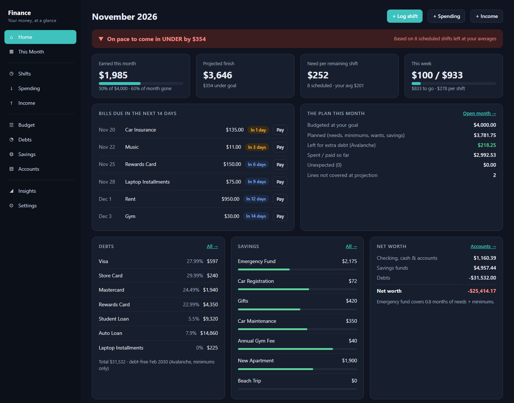
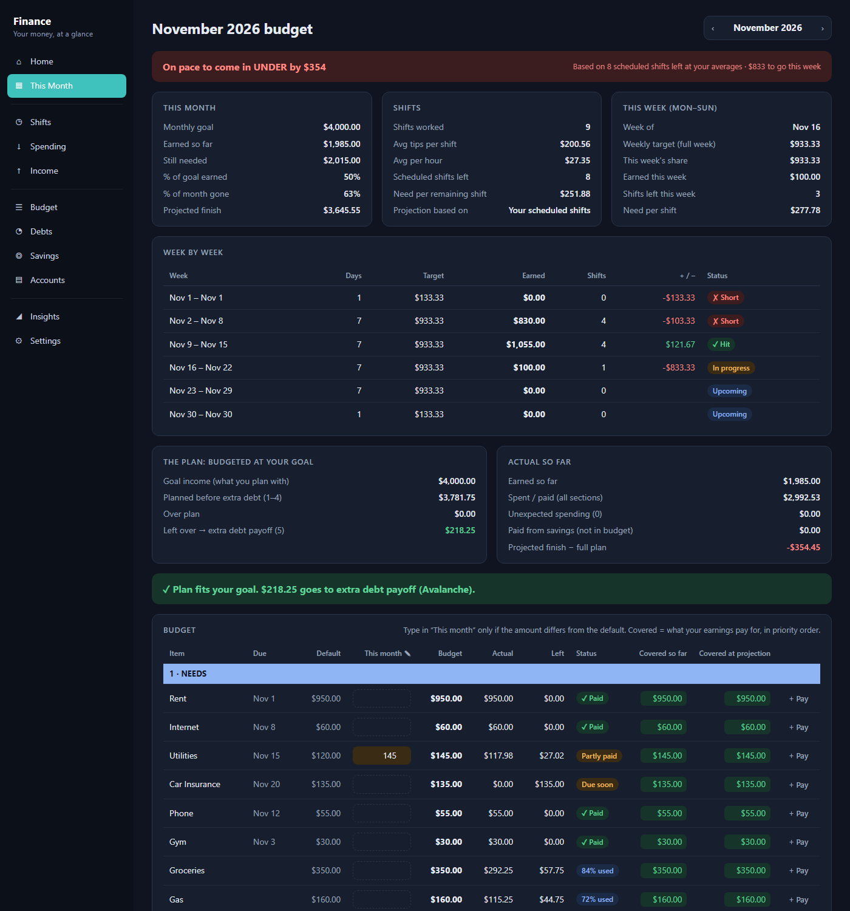
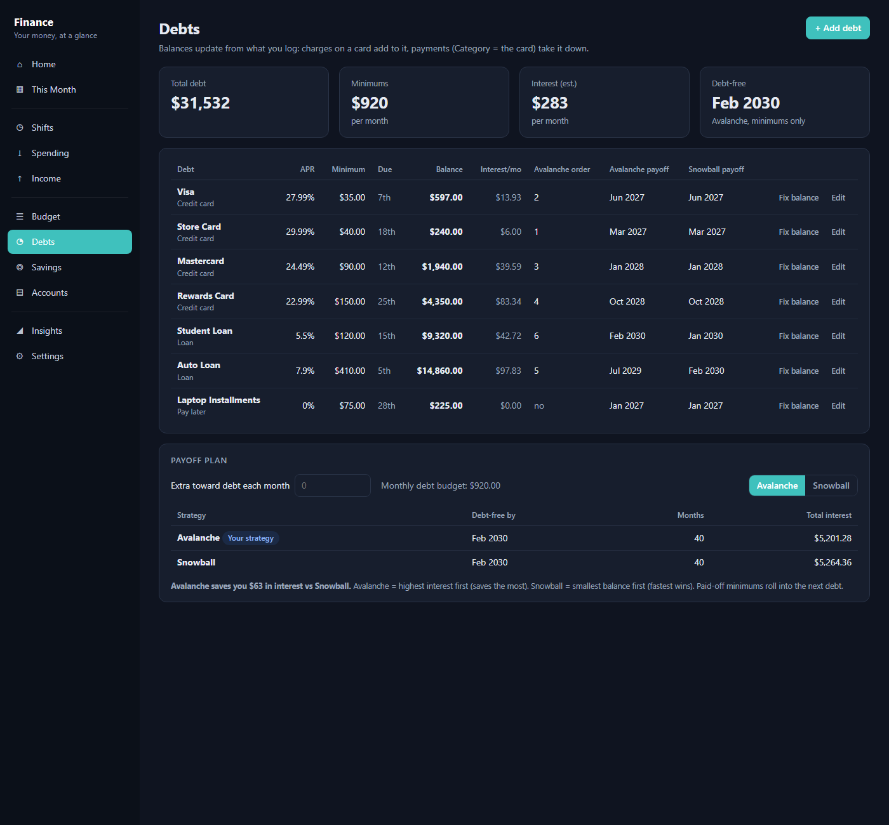
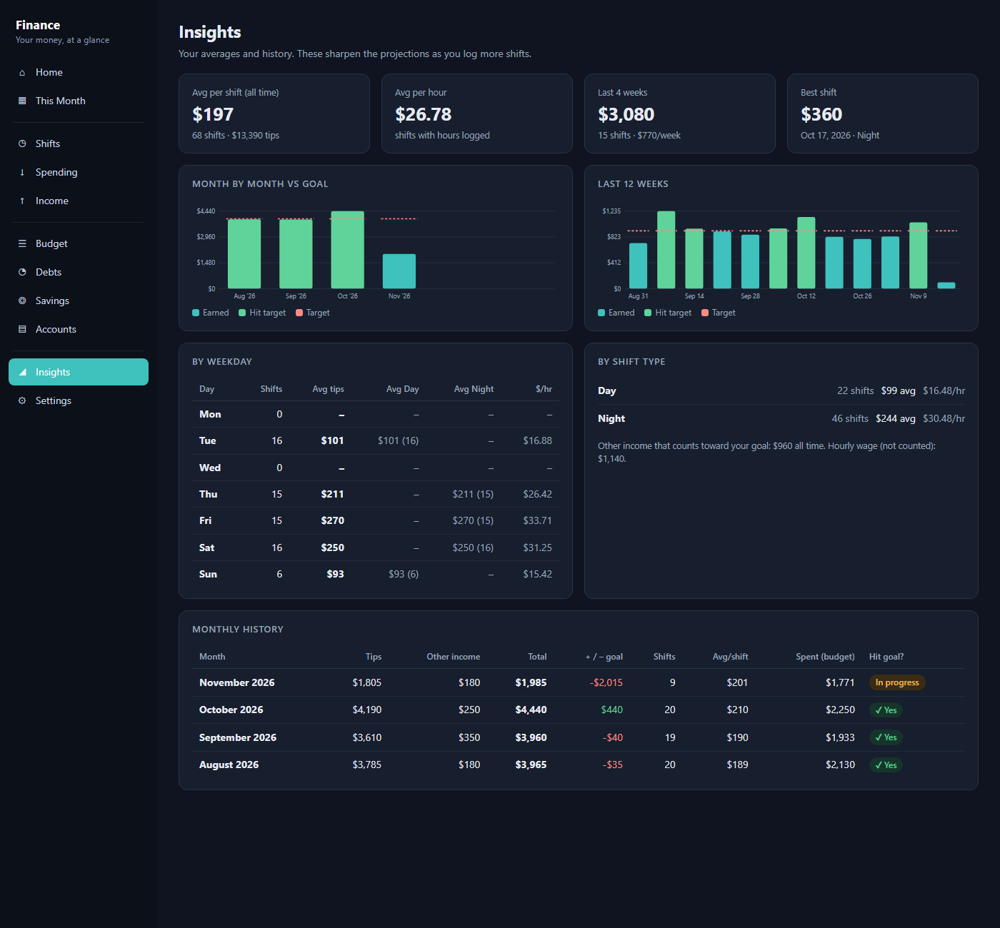
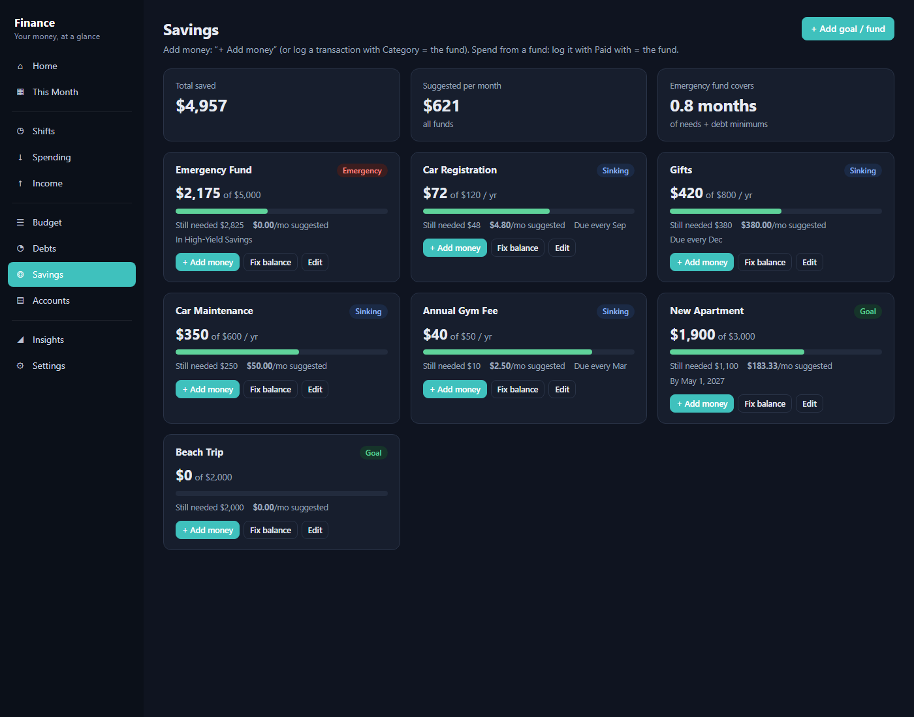

# Finance: budgeting for tip income

A local budgeting app for people whose income changes every shift (bartenders, servers, anyone living on tips).
It plans each month around an income goal, tracks pace by month, week and shift, and shows which bills,
savings and debt payments your earnings are actually covering.

It runs on your own computer: a small Python server plus a browser UI, with your data in one SQLite file.
There are no accounts, no cloud and no dependencies beyond Python itself.



## What it does

- **Pace tracking.** Earned so far, projected finish from your scheduled shifts and your averages per shift
  type, and what you need per remaining shift, for the month and the current week (Monday start).
- **A plan in priority order.** Your goal is budgeted top-down: needs → debt minimums → wants → savings →
  whatever is left goes to extra debt payoff. Each line shows whether it's covered so far and at projection.
- **Per-month overrides.** Utilities ran high? Type this month's amount without changing the default.
- **Bills, subscriptions and spending** with start and end months, so history stays correct when things change.
- **Savings funds.** Sinking funds (annual bills) get a suggested monthly amount that catches up as the due month
  nears, and goals divide the remainder by the months left. Funds can be "kept in" an account so they aren't counted twice.
- **Debt payoff.** Avalanche vs Snowball simulation with minimums rolling over as debts are paid off, payoff
  dates per debt, and an "extra per month" what-if.
- **Insights.** Averages by weekday and shift type, month-by-month vs goal, the last 12 weeks.
- **Your data stays yours.** Automatic daily backups (last 30 kept) and a one-click CSV export.

| This month | Debts |
|---|---|
|  |  |
| **Insights** | **Savings** |
|  |  |

## Run it

Needs Python 3.10 or newer, nothing else.

```sh
python app/server.py --open
```

That opens http://localhost:8765. Running it again while it's already up just reopens the page. If the code has
changed since the server started, it replaces the old server automatically.

On Windows, `Finance.vbs` starts it with no console window (point a desktop shortcut at it).

### Try it with demo data

```sh
python app/seed_demo.py demo.db --today 2026-11-19
FINANCE_DB=demo.db FINANCE_TODAY=2026-11-19 FINANCE_PORT=8799 python app/server.py --open
```

The demo is a made-up bartender with three months of shifts, bills, savings and debts. Every screenshot
here comes from it. (PowerShell: `$env:FINANCE_DB="demo.db"` and so on, then the same command.)

## Where your data lives

Your data is kept outside the code folder, so it can't end up in a commit:

| OS | Database |
|---|---|
| Windows | `%LOCALAPPDATA%\Finance\finance.db` |
| macOS | `~/Library/Application Support/Finance/finance.db` |
| Linux | `$XDG_DATA_HOME/Finance/finance.db` (default `~/.local/share/Finance/`) |

Backups go to a `backups` folder next to it by default; you can change that in Settings. To restore one, stop
the app, copy the backup over `finance.db` and start it again.

| Environment variable | Purpose |
|---|---|
| `FINANCE_DB` | Use a different database file |
| `FINANCE_PORT` | Use a different port (default 8765) |
| `FINANCE_TODAY` | Pretend today is this date (`YYYY-MM-DD`), for demos and testing |

## How it's built

```
app/
  server.py      HTTP server (stdlib ThreadingHTTPServer): JSON API + static files, backups, restart-if-outdated
  calc.py        all the math: balances, pace, the month plan, savings suggestions, payoff simulation, insights
  db.py          SQLite schema, validation, CRUD, safe deletes (archive / end / delete with history)
  seed_demo.py   demo data generator
  static/        single-page UI in plain JavaScript and CSS, with hash routing and no build step
  tests/         unit tests for the math, plus a browser self-test that drives every form
```

A few design choices:

- **Balances are derived, not stored.** Each account, fund and debt has an anchor balance on a date, and its
  current balance is that anchor plus every logged flow after it. Editing an old entry corrects everything
  downstream, and "fix balance" just moves the anchor.
- **The server computes, the browser renders.** Every page asks for one view (`/api/month?m=2026-11`,
  `/api/home`, …), so numbers are identical everywhere they appear.
- **Deleting never corrupts history.** Items with logged entries can be ended (budget items stop after a month)
  or archived (accounts, funds, debts) instead of deleted.

## Tests

```sh
python -m unittest discover -s app/tests
```

The unit tests check the month plan, savings catch-up, overrides, payoff dates and interest for both
strategies, pace and weekly targets, balances and the extra-debt allocation against hand-checked numbers for
a made-up household. GitHub Actions runs them on Linux and Windows.

`app/tests/browser_selftest.html` clicks through every page and form in a real browser. It writes data, so run
it only against demo data. Its header has the steps.

## License

MIT
